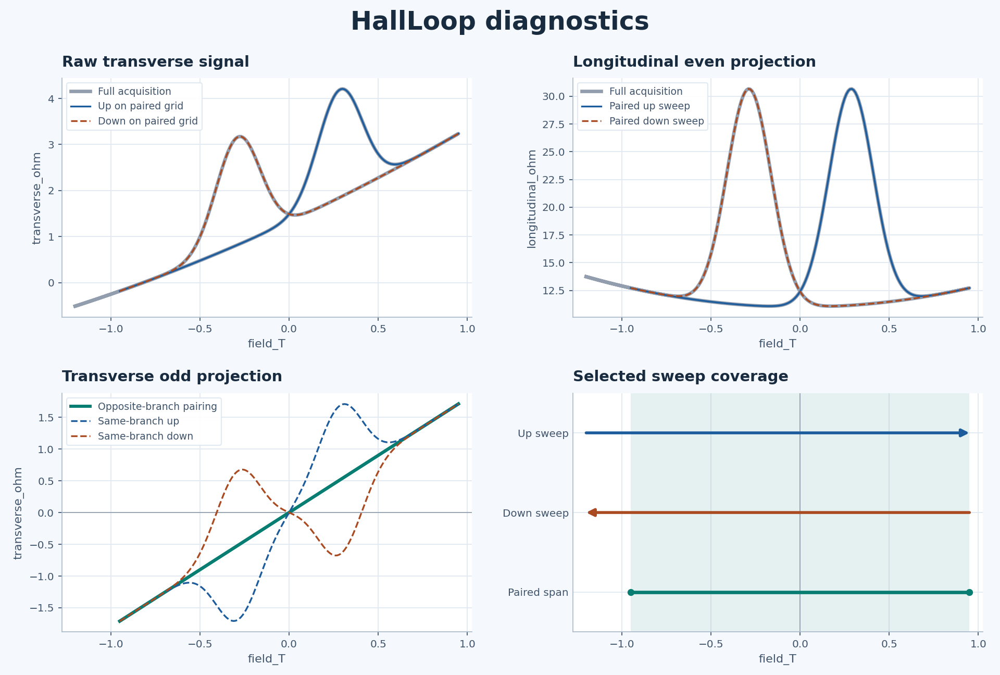

# HallLoop

HallLoop processes longitudinal and transverse magnetotransport sweeps when the magnetic response is hysteretic. It pairs opposite sweep directions at opposite fields, keeps the raw traces visible, and records the processing choices in a replayable recipe.



## Quick start

Run these commands from a clone of this repository using Python 3.10 or newer.

```bash
python -m pip install -e .

hallloop process examples/mixed_loop.csv \
  --field field_T \
  --longitudinal longitudinal_ohm \
  --transverse transverse_ohm \
  --assume-reversal-related \
  --out hallloop-example
```

The example is synthetic. It adds longitudinal pickup to a transverse signal that reverses sign under simultaneous reversal of field and magnetic state. Same-branch subtraction deviates from the planted 1.8 Ω/T Hall line by up to 1.17 Ω. Opposite-branch pairing recovers the line to within 10⁻⁹ Ω on the paired grid. Asymmetric field limits leave part of the measured field range without a mirrored partner. The single-sweep example `examples/incomplete_sweep.csv` illustrates an input that cannot form a pair.

## How pairing works

At field $B$ on one branch, HallLoop evaluates the opposite branch at $-B$. For the increasing branch, the extracted components are

$$
R_{xx}^{\mathrm{even}}(B) =
\frac{R_{xx}^{\uparrow}(B) + R_{xx}^{\downarrow}(-B)}{2},
\qquad
R_{yx}^{\mathrm{odd}}(B) =
\frac{R_{yx}^{\uparrow}(B) - R_{yx}^{\downarrow}(-B)}{2}.
$$

The same pairing rule applies with the branch roles reversed. The same-branch baseline uses the measurements at $B$ and $-B$ from a single sweep, which can pair different magnetic histories and produce artifacts near switching.

Use `--assume-reversal-related` only for an acquisition protocol that prepares reversal-related states on the paired branches of a major loop. Overlap in field establishes numerical coverage. The acquisition protocol establishes whether the magnetic states are related by reversal. Exchange bias, shifted loops, training, and minor loops can break that relation. Those cases can call for separately prepared reversal-related histories or a dedicated reverse-magnetic-field reciprocity measurement. For the experimental assumptions and measurement protocols, see [Moya et al., *Advanced Materials* (2026)](https://doi.org/10.1002/adma.202523674).

## Bring your own data

- Supply a comma- or tab-delimited file with a header row, optionally preceded by instrument metadata ending at a line containing `[Data]`. Select the field, longitudinal, and transverse columns by their exact header names. Quote names containing spaces. Selected columns must contain finite numbers in every data record. Use `--delimiter comma` or `--delimiter tab` to override automatic detection.
- Keep rows in acquisition order. HallLoop finds adjacent increasing and decreasing sweeps that each reach the file's field extrema within `--field-tolerance`. When several pairs qualify, choose the 1-based pair number with `--pair N`. The tolerance also sets how far the field must travel in the opposite direction to confirm a reversal. Its default is zero and its units follow the input field column.
- Use the measured field and signal units. Values stay on their input scales. Convert voltages to resistance with the appropriate excitation current before processing if you want resistance output.
- Inspect the selected field ranges and mirrored coverage before using the result. HallLoop uses linear interpolation within the measured overlap of each branch with the reflected partner. Unmatched portions remain visible in the raw diagnostics. Repeated field values within a branch are averaged. The output grid combines measured and reflected field values within the paired range, so its point count does not represent independent measurements.

## Outputs and replay

Choose a new output directory for each run. It receives three files.

| File | Contents |
| --- | --- |
| `processed.csv` | Paired field points and processed longitudinal and transverse components |
| `diagnostics.png` | Raw sweeps, selected coverage, and same-branch and opposite-branch results |
| `recipe.json` | Input identity, processing settings, selected sweep information, tool version, and output hashes |

Replay checks the input SHA-256 and HallLoop version, reruns the recipe, and reports whether the output hashes match. PNG bytes can differ across rendering environments.

```bash
hallloop replay hallloop-example/recipe.json \
  --input examples/mixed_loop.csv \
  --out hallloop-replay
```

Both commands are also available through `python -m hallloop`.

## Development

```bash
python -m unittest discover -s tests
```

Released under the [MIT License](LICENSE).
